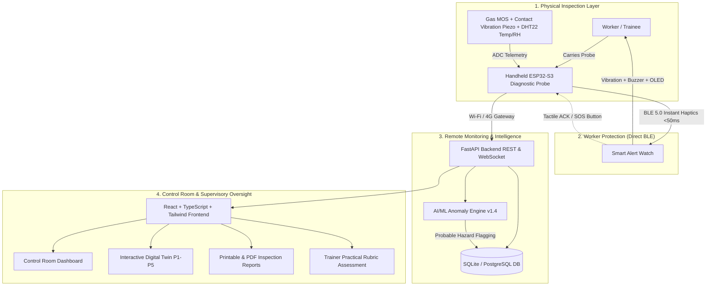

# SkillSafe — AI-Powered Gas Safety, Probable Hazard Localization & Digital Twin Platform

[](https://sih.gov.in)
[](https://react.dev)
[](https://fastapi.tiangolo.com)
[](https://espressif.com)

> **"See the Risk. Protect the Worker."**

SkillSafe is a full-stack, enterprise-grade industrial gas safety, probable hazard localization, and vocational skill assessment platform engineered for the **Smart India Hackathon 2026**.

The platform protects vocational trainees, gas-fitters, plant maintenance workers, and supervisors through an interconnected physical-to-digital loop: from handheld diagnostic sensors and instant wristband BLE alerts, to an interactive pipeline Digital Twin (P1 → P5), rule-assisted AI anomaly localization, and NSQF-aligned practical scoring.

---

## 1. System Architecture



---

## 2. Key Modules & Website Pages

SkillSafe features 12 interconnected, responsive pages:

1. **Landing Overview (`/`)**: SIH concept introduction, 5-pillar architecture, live interactive pipeline demo widget, tech stack, and UN SDG impact (SDGs 3, 8, 9, 11).
2. **Control-Room Dashboard (`/dashboard`)**: Real-time summary cards, live streaming telemetry chart (gas ppm vs vibration RMS), active alerts escalation table, and worker status.
3. **Interactive Digital Twin (`/digital-twin`)**: Virtual SVG pipeline rig (sections P1 → P2 → P3 → P4 → P5) displaying spatial heatmaps, live probe tracking, and evaluator simulation sliders.
4. **Worker Tracking (`/workers`)**: Personnel directory, assigned handhelds & watches, trade wings, search/filter, and candidate registration.
5. **Handheld Diagnostics (`/device-monitoring`)**: Live telemetry dials from ESP32 probe, sensor health matrix, continuous waveform graphs, and hardware specs.
6. **Smart Watch & BLE (`/smart-watch`)**: BLE connection states, wrist haptic alert dispatch, escalation timer configuration, and confirmed SOS signal verification.
7. **AI/ML Hazard Engine (`/ai-analysis`)**: Rule-based anomaly scoring, explainable attribution cards, cross-section risk bar chart, temporal slope gradients, and 4-stage AI roadmap.
8. **Inspection Records (`/inspections`)**: Searchable audit log of sweeps, hazard tags, duration metrics, and supervisor annotation modal.
9. **Historical Trends (`/history`)**: Multi-day sweep volumes, cumulative hazard frequencies by pipe section, and trainee dwell time compliance benchmarks.
10. **Inspection Reports (`/reports`)**: Official printable and downloadable certificate report complete with multi-sensor data tables and supervisory digital seal.
11. **Trainer Assessment (`/assessment`)**: 7-point practical evaluation rubric supporting proposed NSQF practical trade certification.
12. **Admin & Settings (`/admin`)**: Safety threshold rules, physical sensor zero-point calibration registry, immutable audit logs, and Role-Based Access Control (RBAC).

---

## 3. Technology Stack

- **Frontend**: React 18, TypeScript, Vite, Tailwind CSS v3, Recharts, Lucide React, React Router v6.
- **Backend API**: Python 3.10+, FastAPI, SQLAlchemy, Pydantic v2, WebSockets, ReportLab.
- **Database**: SQLite (default zero-config development) / PostgreSQL (production ready).
- **Edge Microcontroller**: Espressif ESP32-S3 (Dual-core Xtensa @ 240MHz, BLE 5.0, Wi-Fi 802.11 b/g/n).
- **Sensors**: Calibrated Gas sensor (MOS / MQ / Figaro), Contact piezoelectric acoustic vibration transducer, DHT22/BME280.

---

## 4. Quickstart: Running Locally

### Prerequisites
- Node.js v18+ and npm installed
- Python 3.10+ installed

### Step 1: Run the Frontend
```bash
# Navigate to the frontend directory
cd C:\Users\user\.gemini\antigravity\scratch\skillsafe

# Install dependencies (already pre-installed)
npm install

# Start Vite development server
npm run dev
```
Open **`http://localhost:5173`** in your browser.

### Step 2: Run the Backend API (Optional for Live Mode)
```bash
# Navigate to backend directory
cd C:\Users\user\.gemini\antigravity\scratch\skillsafe\backend

# Create virtual environment and install requirements
python -m venv venv
venv\Scripts\activate
pip install -r requirements.txt

# Seed initial database
python -m app.seed

# Start FastAPI server
uvicorn app.main:app --host 0.0.0.0 --port 8000 --reload
```
API Documentation will be live at **`http://localhost:8000/docs`**.

---

## 5. Hardware Integration: Connecting Physical ESP32-S3

The handheld diagnostic device streams telemetry to the backend via HTTP POST:

### Endpoint: `POST /api/readings`
```http
POST /api/readings HTTP/1.1
Host: your-server-ip:8000
Content-Type: application/json

{
  "device_id": "SS-HANDHELD-ESP32-02",
  "worker_id": "w-102",
  "timestamp": "2026-10-12T11:47:30.142Z",
  "gas_reading": 138.9,
  "gas_unit": "ppm CH4 eq.",
  "vibration_reading": 1.28,
  "temperature": 32.8,
  "humidity": 43.1,
  "section_id": "P4",
  "distance_cm": 245.0,
  "battery_percent": 42,
  "connectivity_status": "online",
  "alert_level": "critical"
}
```

Check [`hardware/esp32_firmware_sample.ino`](hardware/esp32_firmware_sample.ino) for the ready-to-flash Arduino/ESP-IDF C++ sketch.

---

## 6. Safety & Ethical Disclaimers

1. **Probable Hazard Localization**: The platform uses wording such as *"Probable Hazard Zone"* and *"Possible Gas Hazard"*. It does not claim that prototype hardware or AI independently confirms an active gas leak without human secondary verification.
2. **No Fake ML Claims**: In accordance with SIH evaluation integrity, the MVP utilizes a clearly documented Stage 1/2 rule-based anomaly detector with a modular interface for future ML model integration.
3. **NSQF Transparency**: The vocational assessment rubric is labeled as *proposed NSQF-aligned practical assessment support* and does not claim official government accreditation.
4. **Vibration Independence**: Vibration and acoustic sensors measure local pipe turbulence; vibration alone is never treated as definitive proof of a gas leak.

---

## 7. Smart India Hackathon 2026 Evaluation Checklist

- [x] Full-stack responsive web application with dark navy industrial aesthetic.
- [x] All 12 required pages fully built and functional with rich interactive controls.
- [x] Interactive SVG Digital Twin model (P1 → P5) with live simulation sliders.
- [x] Direct BLE wristband alert escalation architecture and SOS verification flow.
- [x] Rule-based AI hazard explainability and 4-stage progression plan.
- [x] Printable PDF inspection report generator with official supervisory seal.
- [x] Ready-to-use ESP32-S3 firmware sample, JSON payload schemas, and BLE GATT specs.
- [x] Production build tested and verified (`dist/` compiled with 0 errors).
