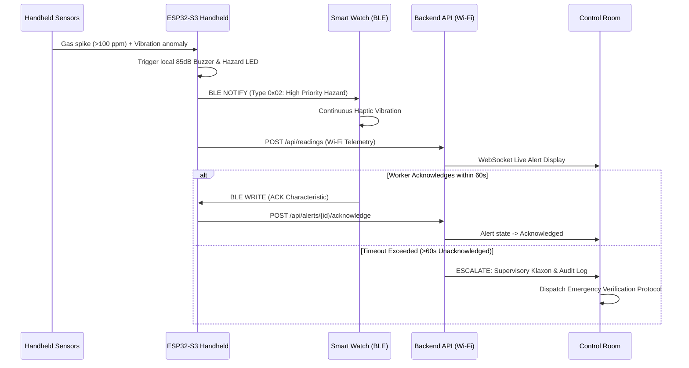

# SkillSafe: Handheld to Smart Watch BLE Architecture & Hardware Design

This document details the Bluetooth Low Energy (BLE) alert protocol and physical sensor integration for **SkillSafe**, designed for the Smart India Hackathon 2026.

---

## 1. Physical Hardware Components

### A. Handheld Diagnostic Probe
- **Microcontroller**: Espressif ESP32-S3-WROOM-1 (Dual-core Xtensa LX7 @ 240MHz, 8MB Flash, 2MB PSRAM)
- **Gas Sensor**: Calibrated MOS sensor (e.g. MQ-4 / MQ-2 or Figaro TGS2611 for Methane CH4 detection) with 12-bit ADC filtering and baseline temperature drift compensation.
- **Vibration & Acoustic Sensor**: Contact piezo film / MEMS accelerometer (ADXL345 or piezoelectric acoustic disc) clamped to the probe tip to capture high-frequency surface turbulence (0.1–10 kHz).
- **Environmental Sensor**: DHT22 / BME280 for ambient temperature and relative humidity compensation.
- **Wheel Encoder (Optional)**: Incremental rotary optical encoder measuring continuous distance traverse (cm).
- **User Interface**: 0.96" I2C OLED display (128x64), 85dB active piezoelectric buzzer, red hazard strobe LED.

### B. Smart Alert Watch
- **Microcontroller**: Nordic nRF52840 or ESP32-C3 wearable board.
- **Haptic Engine**: ERM / LRA vibration motor driver (e.g., DRV2605L).
- **Display**: Color circular or rectangular OLED.
- **Emergency Input**: Dedicated physical SOS tactile switch (long-press 3 seconds).

---

## 2. BLE GATT Service & Characteristics

The handheld device acts as the **BLE GATT Server (Peripheral)** and the Smart Watch acts as the **BLE GATT Client (Central)**.

### Custom Safety Service UUID: `4F530001-5349-4832-3032-365341464500`

| Characteristic | UUID | Properties | Format / Payload | Description |
|---|---|---|---|---|
| **Alert Notification** | `4F530002-...` | `READ`, `NOTIFY` | 4-byte packed struct: `[alert_type, severity, section_id, seq_num]` | Dispatched instantaneously when handheld sensor triggers hazard threshold |
| **Worker Acknowledgement** | `4F530003-...` | `WRITE`, `WRITE_WITHOUT_RESP` | 2-byte struct: `[seq_num, ack_status]` | Transmitted from watch when worker presses physical ACK button |
| **SOS Emergency** | `4F530004-...` | `WRITE`, `NOTIFY` | 1-byte flag: `[0x01 = SOS_TRIGGERED, 0x02 = SOS_ACKED]` | Critical emergency trigger; requires bidirectional handshake confirmation |
| **Telemetry Summary** | `4F530005-...` | `READ`, `NOTIFY` | 6-byte struct: `[gas_ppm (2B), vib_rms (2B), batt (1B), status (1B)]` | Periodic 1 Hz low-power summary for watch display |

---

## 3. BLE Notification Types & Haptic Patterns

| Notification Type Code | Description | Wrist Haptic Vibration Pattern | OLED Display Text |
|---|---|---|---|
| `0x01` | **Warning: Abnormal Gas Gradient** | Double short buzz (200ms ON, 100ms OFF, 200ms ON) | `WARN: SLOW DOWN (P3)` |
| `0x02` | **High-Priority Probable Hazard** | Continuous pulsating buzz until ACK or 30s timeout | `EVACUATE: HAZARD (P4)` |
| `0x03` | **Acknowledgement Received** | Single gentle buzz (150ms) | `ACKNOWLEDGED` |
| `0x04` | **Inspection Reminder / Dwell** | Triple micro-pulse (50ms x 3) | `DWELL SECTION COMPLETE` |
| `0x05` | **Low Battery Warning** | Long buzz (500ms) | `HANDHELD BATT < 20%` |
| `0x06` | **SOS Distress Request** | Maximum intensity pulsing alarm | `SOS TRANSMITTED` |

---

## 4. Alert Escalation Workflow

---

## 5. Offline Operation & Flash Resynchronization

When physical inspection occurs in tunnels, steel structures, or RF-shielded pipeline vaults where Wi-Fi is unavailable:
1. **Local Worker Protection Remains Active**: Handheld-to-watch BLE communication runs on 2.4GHz GFSK direct RF without needing server connectivity.
2. **SPIFFS / LittleFS Burst Logging**: The ESP32 logs readings to onboard flash memory with 1-second interval timestamps.
3. **Automatic Resynchronization**: Upon reconnecting to Wi-Fi, the handheld checks `/api/health` and flushes queued records via batch JSON POST to `/api/readings`.
